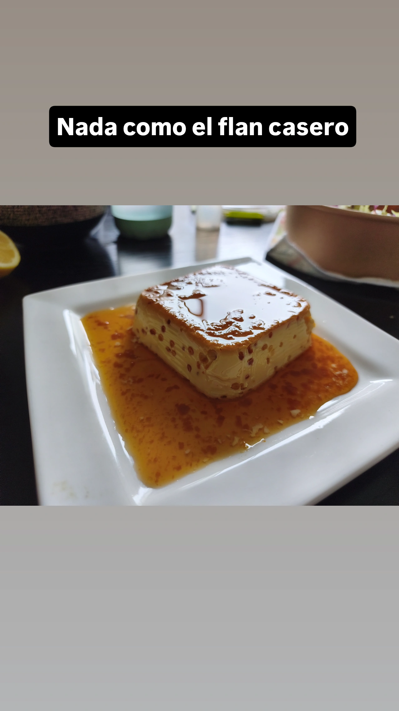
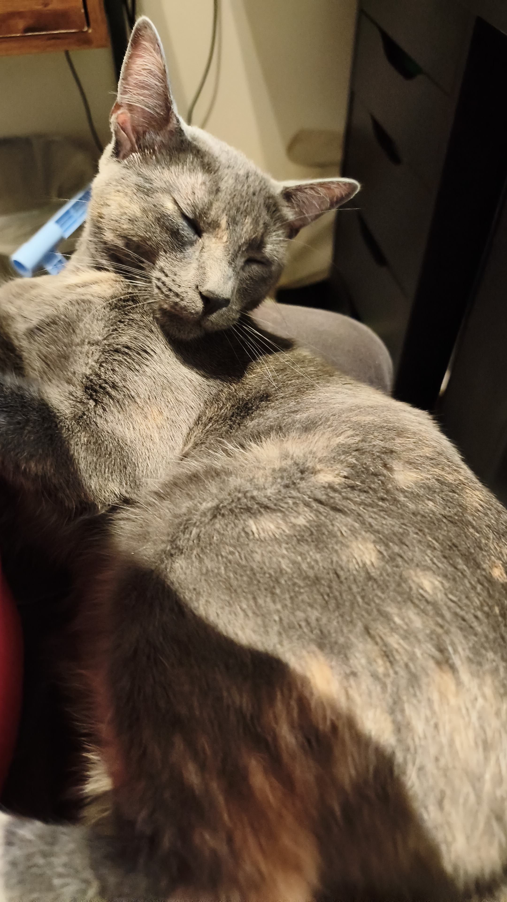

# cardenaspenaluisa-svg.github.io

# Luis Agustín Pena
## Research interests

I am a mathematician, researcher, and university lecturer working primarily in algebraic combinatorics. My research focuses on symmetric and nonsymmetric functions, tableaux, key polynomials, and the Robinson–Schensted–Knuth correspondence. I am particularly interested in bijective proofs and combinatorial descriptions of relationships between polynomial bases. I have also worked on parking functions.

## Education background

I completed my Ph.D. in Mathematics at Universidad de Talca, Chile, in March 2026 under the supervision of Professor Luc Lapointe. My dissertation, *Schur Bases for the Ring of \(m\)-Symmetric Functions*, develops connections between symmetric functions and their nonsymmetric counterparts.

Previously, I earned a bachelor’s degree in Mathematics from Universidad Nacional del Comahue, Argentina, where I wrote my thesis, *Mixed Formulation of Eigenvalue Problems*, under the supervision of Professor Claudio Padra. I subsequently earned a master’s degree in Mathematical Sciences from Universidad de Talca, with a thesis entitled *A Waring Problem for Quadratic Forms*, supervised by Professor María Inés Icaza.

Throughout my academic career, I have combined research with university teaching. I value teaching and outreach as opportunities to share mathematical ideas, encourage curiosity, and support students in developing their own mathematical understanding.

## Publications

1. Susanna Fishel and **Luis Pena**.
   “Parking functions with zero secondary *dinv*.”
   *Arabian Journal of Mathematics* **15**(2) (2026), 725–733.
   [DOI](https://doi.org/10.1007/s40065-025-00562-8).

2. **Luis Agustín Cárdenas Pena**.
   “Recortando polígonos, de las tijeras a la generalización”
   [“Cutting polygons: From scissors to generalizations”].
   *Revista de Educación Matemática* **35**(2) (2020), 51–69.
   [DOI](https://doi.org/10.33044/revem.29729).
   In Spanish.

## Preprints

1. Luc Lapointe and **Luis Pena**.
   “A proof of the *m*-Symmetric Macdonald positivity at *t* = 1.”
   Preprint (2026).
   [arXiv:2608.10223](https://arxiv.org/abs/2608.10223).

2. Luc Lapointe and **Luis Pena**.
   “A new characterization of right keys, and the *m*-symmetric Schur functions at *t* = 0.”
   Preprint (2026).
   [arXiv:2608.13276](https://arxiv.org/abs/2608.13276).

3. **Luis Pena**.
   “Cauchy identities for skew Ferrers shapes via RSK and keys.”
   Preprint (2026).
   [arXiv:2609.15852](https://arxiv.org/abs/2609.15852).

## Hobbies

Physical activity is an important part of my life as a mathematician. It helps me clear my head and return to problems with a fresh perspective—and some of my best ideas arrive while my legs are busy.

I enjoy calisthenics, especially pull-ups and push-up variations, as well as cycling and weightlifting. Although I started strength training relatively late, I am proud of reaching one-rep maximums of **106 kg on the bench press, 150 kg on the squat, and 200 kg on the deadlift**—all while writing my thesis! My long-term ambition is to reach **140 kg on the bench press, 220 kg on the squat, and 300 kg on the deadlift**. Those are ambitious targets—getting tenure might be easier—so my intermediate goals are 120, 180, and 250 kg, respectively. As in mathematics, I enjoy having a difficult problem to work toward.

There is something satisfying about lifting a weight after spending the day wrestling with an abstract problem. At least in the gym, I know exactly how heavy the challenge is. Many of my best ideas have come while cycling through the countryside with my partner, who patiently puts up with me when my thoughts wander off into an interesting tableau construction.

I also enjoy films and narrative-driven video games. Stepping into someone else’s shoes can transport you to another world, even when the people are real and the setting is familiar. What interests me most is how people relate to the world, to one another, and to themselves. One might even argue that our relationship with the world is functorial. I enjoy overanalyzing fiction: seeing how the pieces fit together and trying to understand the author’s choices. For me, this deepens the appreciation of a work, revealing how narrative techniques intertwine with the audience’s emotions.

I love cooking. Working dough with my hands helps me feel grounded when so much of life takes place in books or on screens. I also love the sharing that comes with it. As my colleagues and I follow different research paths, technical conversations can become harder, but we can always enjoy a pizza, alfajores de dulce de leche, flan, or whatever dish I am practicing.

Although I cook to relax, I firmly believe that practice makes perfect. The kitchen gives me a chance to keep learning, connect with friends and colleagues, and give my mathematical mind a rest.

## Pets

Although it is not exactly a hobby, I am very fond of cats. They make excellent study companions, happy to sit beside you while you struggle with category theory—a subject surely beneath such Egyptian deities. Calling it “cat theory” seems rather presumptuous. I currently worship Maomao, a grey female cat whom I have persuaded to take an interest in a more earthly pursuit: goalkeeping. She loves catching the ball and has remarkable reflexes. Should she ever turn professional, even Messi and Cristiano Ronaldo might struggle to score a penalty against her.

